# Phase 18.2 — Module Dependencies

## Refactored boundaries

```mermaid
flowchart TD
    UI[ui.py / Streamlit coordinator] --> CTX[dashboard.context]
    UI --> CASE[dashboard.case_loader]
    UI --> STATE[dashboard.session_state]
    UI --> LOAD[dashboard.analysis_loader]
    UI --> ADAPT[dashboard.workspace_adapter]
    UI --> CTRL[dashboard.simulation_controller]
    CTRL --> SIM[services.simulation_service]
    UI --> VIEWS[dashboard.views]
    VIEWS --> REPORT[services.report_service]
    VIEWS --> DL[dashboard.downloads]
    UI --> DS[datasheet.datasheet_ui]
    DS --> DOC[datasheet.ui_document]
    DS --> REVIEW[datasheet.ui_candidate_review]
    DS --> APPLY[datasheet.ui_application]
    UI -. PCB view .-> VUI[vision_ui.render_vision_tab]
    CTRL --> CTX
    CTX --> WS[workspace context and provenance]
    SIM --> SP[simulation fingerprint and manifest]
    DL --> FS[bounded filesystem snapshot]
    DOC --> DSH[datasheet.ui_helpers]
    REVIEW --> DSH
    APPLY --> DSH
    DS --> PDF[PDF and evidence validation]
    DS --> RATE[rating review and adapter]
    VUI --> OVIEW[vision.overlay_view]
    VUI --> VC[vision.ui_context]
    OVIEW --> VISION[vision overlay and registration]
```

## Responsibilities

| Module | Responsibility | State/process ownership |
| --- | --- | --- |
| `circuitcare.ui` | Streamlit entry, request coordination, active-view routing, compatibility exports | Existing Session State names and transitions are preserved |
| `dashboard.context` | Analysis context key, cache/result identity, measurement set identity, result reuse predicates | No Streamlit dependency |
| `dashboard.case_loader` | Static demo circuit definitions and fault options | No Streamlit widgets or I/O side effects |
| `dashboard.session_state` | Pure invalidation policy plus a thin Session State adapter | Existing state-key policy remains unchanged |
| `dashboard.analysis_loader` | JSON snapshot reads and manifest/status classification | Invalid cached provenance fails closed |
| `dashboard.simulation_controller` | Command construction and normalized simulation outcomes | Delegates process execution and manifest validation to the existing service |
| `dashboard.workspace_adapter` | Workspace analysis record construction | Reuses the established record/status contract |
| `dashboard.views` | Workflow, What-if, fault map, report panel, raw downloads | Presentation only; report data is supplied as an explicit snapshot |
| `services.report_service` | Diagnostic snapshot assembly from explicit context and read-only state | No Streamlit import or direct session access |
| `dashboard.downloads` | Bounded CSV digest and immutable cached snapshot | Cache is keyed by path, digest, and context as before |
| `services.simulation_service` | ngspice CLI subprocess invocation and live output/manifest validation | Preserves `close_fds=False`, absolute CLI paths from caller, timeout, and output file contract |
| `datasheet.datasheet_ui` | Datasheet workflow coordinator | Existing Datasheet Session State contract |
| `datasheet.ui_document` | PDF metadata, candidate list, and source-page evidence presentation | Candidate evidence validation is reused |
| `datasheet.ui_candidate_review` | Candidate field entry and approve/reject/manual-review records | Explicit user gates, MPN check, evidence status, and condition note are preserved |
| `datasheet.ui_application` | Approved rating apply/revoke and old/current risk comparison | Reuses existing stress; does not rerun SPICE |
| `datasheet.ui_helpers` | Pure source/document matching and risk comparison row preparation | No Streamlit dependency |
| `vision_ui` | Image upload, board correction, CSV alignment inputs, confirmation interaction | Existing `vision_*` Session State keys |
| `vision.ui_context` | Immutable view/registration contracts and manifest-gated overlay eligibility | `SUCCESS`/verified or `CACHED_SIMULATION`/verified only |
| `vision.overlay_view` | Confirmed location mapping, risk overlay rendering, evidence details and exports | Receives two context objects; called only after same-board and confirmation checks |

## Import direction and cycle check

The new helper and service modules do not import `circuitcare.ui` or Streamlit. Compatibility runs in one direction: `ui.py` imports/re-exports helper names. Datasheet views call existing PDF, evidence, and rating services. Vision's confirmed-overlay view receives compact contexts and output callbacks, so it does not import its caller. The resulting refactored module graph is acyclic.

The existing graph, SPICE runner, diagnosis, reporting, workspace, and risk engines remain authoritative domain modules. The Streamlit UI consumes them; they do not depend on the new dashboard modules.
