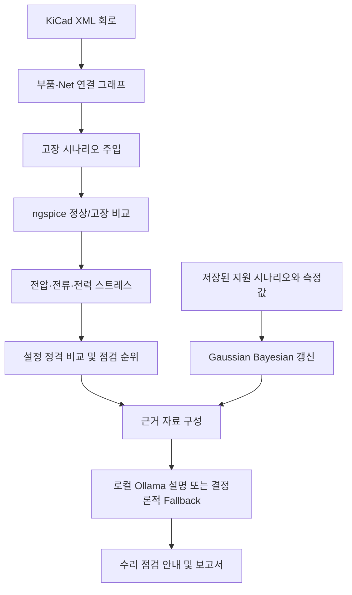
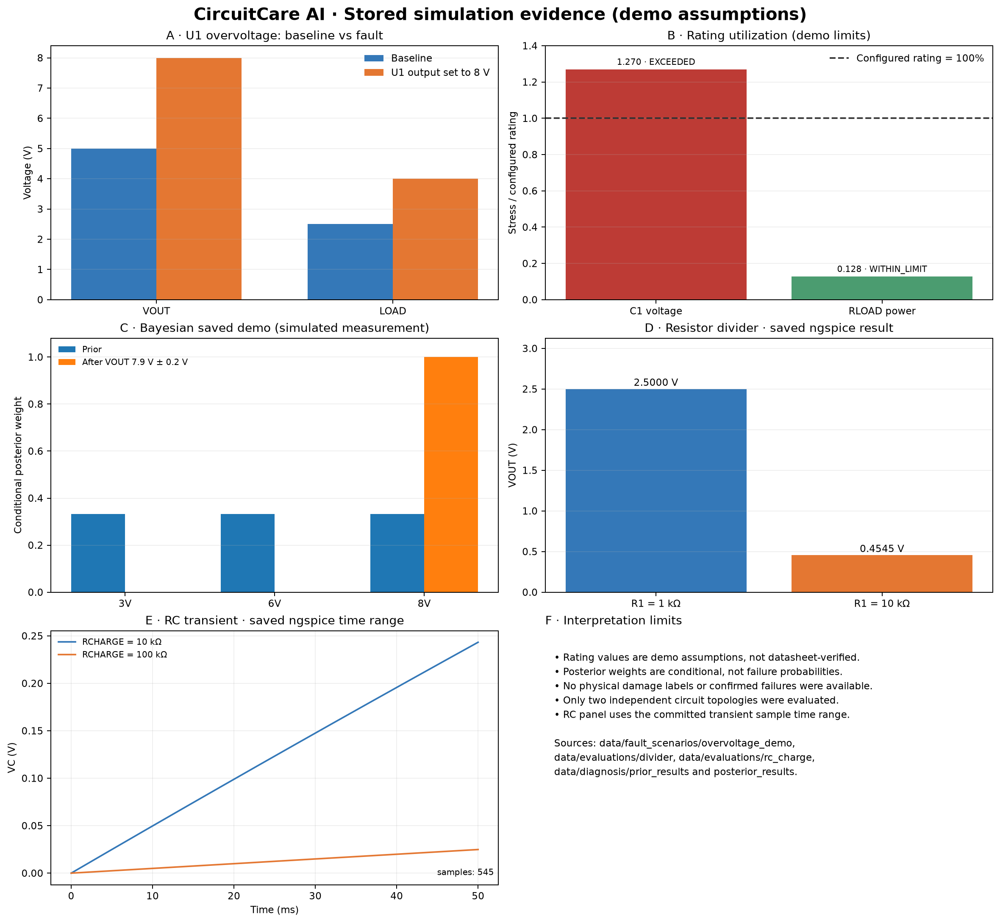

# CircuitCare AI: 물리 기반 회로 고장 영향 분석 및 로컬 AI 수리 지원 시스템

> 포스터 제출용 콘텐츠 초안입니다. 대회 양식 및 제출 규격은 이 저장소에서 확인되지 않아 임의의 크기나 레이아웃은 지정하지 않았습니다. 이 파일은 포스터 제출 완료를 뜻하지 않습니다.

## 연구 배경

회로의 한 부품이 고장 나면 연결된 다른 부품의 전압·전류·전력 조건도 달라질 수 있습니다. 연결 관계만으로는 실제 전기적 스트레스를 알 수 없고, 스트레스가 계산되더라도 실제 손상 여부는 별도의 측정으로 확인해야 합니다. 따라서 연결 후보와 물리 기반 계산, 명시된 정격 비교를 구분해 제시하는 지원 도구가 필요합니다.

## 연구 목적

KiCad 회로 넷리스트에서 고장 부품과 고장 유형을 선택하고, 지원되는 회로는 정상·고장 조건을 ngspice로 비교합니다. 계산된 스트레스와 설정 정격을 근거로 우선 점검 후보를 정리하고, 설정된 시나리오에 한해 Bayesian 측정 갱신과 로컬 LLM 설명을 제공합니다. 출력은 고장 확률이나 손상 확정 판정으로 해석하지 않습니다.

## 시스템 구조

## 핵심 방법

- **연결 그래프:** 부품–Net 이분 그래프에서 직접·간접 연결 후보를 찾습니다. 연결은 영향 경로 후보이며 손상을 증명하지 않습니다.
- **정상/고장 시뮬레이션:** 명시적 KiCad–SPICE 매핑과 지원 모델을 사용해 ngspice의 기준 상태와 고장 상태를 비교합니다.
- **정격 사용률:** 측정 가능한 스트레스를 설정 정격과 비교합니다. `EXCEEDED`는 계산 스트레스가 입력 정격 가정을 넘었다는 의미입니다.
- **Bayesian 진단:** 저장된 U1 3/6/8 V 시나리오와 전압 측정 모델로 조건부 Posterior 및 다음 정보량 기반 측정 후보를 계산합니다.
- **근거 기반 설명:** 선택된 분석 컨텍스트의 근거를 로컬 LLM에 제공하고, LLM 사용이 불가능하면 결정론적 안내를 제공합니다.

## 실험 방법 및 결과

모든 결과는 저장소의 JSON/CSV 산출물에서 가져왔습니다. 포스터 그림은 `python scripts/make_poster_figures.py`로 재생성할 수 있습니다.

| 데모 | 조건 | 관찰된 저장 결과 |
|---|---|---|
| U1 출력 상승 | 기준 5 V, 고장 8 V | VOUT 5→8 V, LOAD 2.5→4 V |
| C1 예시 정격 | C1 6.3 V demo assumption | 스트레스 8 V, 사용률 1.2698, `EXCEEDED` |
| RLOAD 예시 정격 | RLOAD 125 mW demo assumption | 고장 스트레스 16 mW, 사용률 0.128, `WITHIN_LIMIT` |
| Bayesian 저장 시연 | VOUT 7.9 V ± 0.2 V, `simulated_demo` | 8 V 가설의 조건부 Posterior가 약 1.0 |
| 저항 분압 | R1 1 kΩ→10 kΩ, R2 1 kΩ, 입력 5 V | VOUT 2.5000→0.4545 V |
| RC 충전 | RCHARGE 10 kΩ→100 kΩ | CSV 기준 0–50 ms, 545 samples; 마지막 VC 0.24325→0.02488 V |

### 결과 해석

- 그래프 결과는 연결 후보와 시뮬레이션된 전기적 변화 및 설정 정격 비교를 보여줍니다.
- 정격은 발표 예시 가정이며 제조사 데이터시트에서 자동 검증된 값이 아닙니다.
- Bayesian 결과는 저장된 3/6/8 V 가설 집합과 `simulated_demo` 관측에 조건부입니다.
- 측정 가중치와 점검 순위는 실제 고장 확률이 아니며 물리적 손상은 별도로 확인하지 않았습니다.

## 차별화

회로 연결 그래프만 사용하지 않고 지원되는 소자에 대해 시뮬레이션한 전기적 변화와 명시적 부품 정격을 함께 보여줍니다. 이후 측정값으로 제한된 Bayesian 가설을 갱신하고, 그 출처와 한계를 유지한 채 로컬 AI 또는 결정론적 규칙으로 설명합니다.

## 한계

- 지원하는 SPICE 모델과 매핑이 제한적입니다.
- 정격 값 중 일부는 데이터시트 확인 전의 시연용 가정입니다.
- 시뮬레이션만으로 실제 부품 손상이나 고장 확률을 판정하지 않습니다.
- 독립 회로 토폴로지는 저항 분압과 RC 충전의 두 가지입니다.
- 제조사 정격 자동 검증, PCB 이미지 위치 탐색, 범용 KiCad→SPICE 변환은 구현하지 않았습니다.
- 실제 손상 부품의 정답 데이터가 없어 손상 탐지 정확도를 평가하지 않았습니다.

## 향후 연구

KiCad–SPICE 모델 매핑 지원 확대, 제조사 데이터시트 정격과 출처 연동, 실제 실험 측정 및 손상 라벨을 이용한 검증, PCB 이미지 기반 부품 위치 표시, 더 다양한 회로 계열 평가를 수행할 수 있습니다.

## 그림 및 수치 출처

- U1 출력, C1/RLOAD 정격: `data/fault_scenarios/overvoltage_demo/simulation_results/fault_u1_regulator_output_rise/`
- 저항 분압: `data/evaluations/divider/simulation_results/fault_r1_resistance_drift/`
- RC 충전: `data/evaluations/rc_charge/simulation_results/fault_rcharge_resistance_drift/`
- Bayesian prior/posterior: `data/diagnosis/prior_results/` 및 `data/diagnosis/posterior_results/`
- 실행 환경 및 측정 시간: `data/evaluations/phase09_summary.json`
